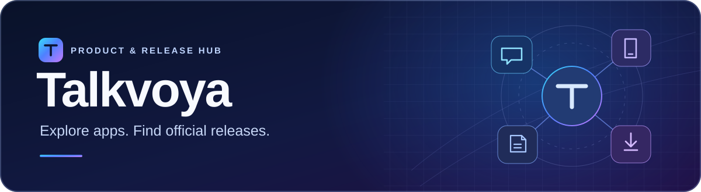

# Talkvoya

**Explore Talkvoya apps, download official releases, and find everything you need to get started.**

[Website](https://talkvoya.com/) · [Products](#products) · [Official channels](#official-channels) · [Simplified Chinese](README.zh-CN.md)

## Products

| Product | Platform | What it does | Get started |
| --- | --- | --- | --- |
| **Talkvoya Harness** | Android · ARM64 | A mobile AI workspace for conversation, document tasks, and optional phone control. | [Product and setup guide](TalkvoyaHarness/) · [Latest release](https://github.com/Talkvoya/Talkvoya.com/releases/latest) |

## Download with confidence

Each release page lists the version, installation files, and SHA-256 checksums. Compare the checksum of the APK you downloaded with the published value before installing it.

[All releases](https://github.com/Talkvoya/Talkvoya.com/releases) · [Harness use notice in Simplified Chinese](TalkvoyaHarness/DISCLAIMER.md) · [Third-party notices in Simplified Chinese](TalkvoyaHarness/THIRD_PARTY_NOTICES.md)

## Official channels

[Website](https://talkvoya.com/) · [YouTube](https://www.youtube.com/@Talkvoya) · [X](https://x.com/Talkvoya) · [Instagram](https://www.instagram.com/talkvoya) · [Facebook](https://www.facebook.com/Talkvoya) · [Threads](https://www.threads.com/@talkvoya) · [TikTok](https://www.tiktok.com/@talkvoya)

**Stay in the loop.** Star this repository to save it, follow Talkvoya on GitHub for product news, or select **Watch → Custom → Releases** to receive release notifications. [Follow Talkvoya](https://github.com/Talkvoya)
