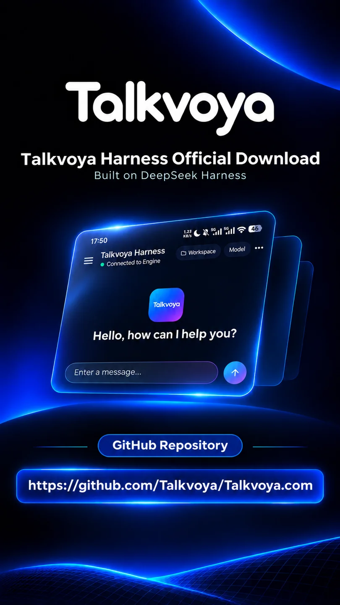
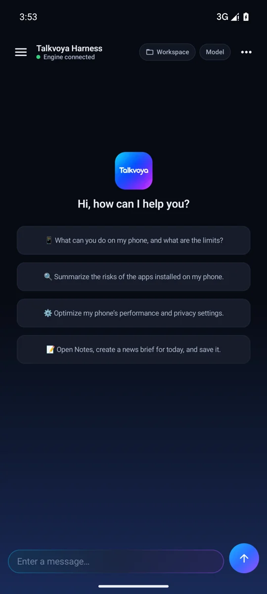
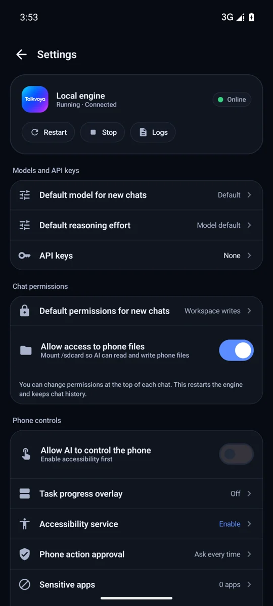

# Download Talkvoya Harness

[Product](README.md) · [Install and get help](HELP.en.md) · [简体中文](DOWNLOAD.md)

**Latest stable release · 1.5.7 · November 7, 2026 (JST)**

[**Download signed ARM64 APK**](https://github.com/Talkvoya/Talkvoya.com/releases/download/v1.5.7/talkvoya-harness-1.5.7-arm64.apk)

| Requirement | Details |
| --- | --- |
| Android | Android 8.0 or later |
| Processor | ARM64 (`arm64-v8a`) |
| Download size | 134 MB (140,180,194 bytes) |
| Runtime setup | Allow about 1.4 GB of free space |
| Price | Free to use forever. Your chosen model provider may charge for usage. |

## App preview

  

## Verify the download

1. Download the APK and the [SHA-256 file](https://github.com/Talkvoya/Talkvoya.com/releases/download/v1.5.7/talkvoya-harness-1.5.7-arm64.apk.sha256).
2. Run `Get-FileHash -Algorithm SHA256 .\talkvoya-harness-1.5.7-arm64.apk` in PowerShell or `shasum -a 256 talkvoya-harness-1.5.7-arm64.apk` in a shell.
3. Compare the output with the published SHA-256 below.

```text
754d8f6aeda5d9f31d6e77a26d5848ae3cf1a98617ddb73ff6d5bd0b15ae9699
```

APK signing certificate SHA-256

```text
838e430be3ea0eaf057bf937ae074269f5a98287948186eeaa8fafa34e303cb9
```

[Install and upgrade](HELP.en.md) · [Latest release notes](RELEASE_NOTES.en.md) · [GitHub release](https://github.com/Talkvoya/Talkvoya.com/releases/tag/v1.5.7)

GitHub generates `Source code` ZIP and TAR archives from the public repository tag. The installable file is the signed APK. [Third-party licenses and source materials](TRUST.en.md)
