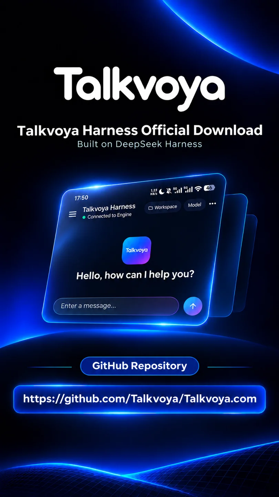
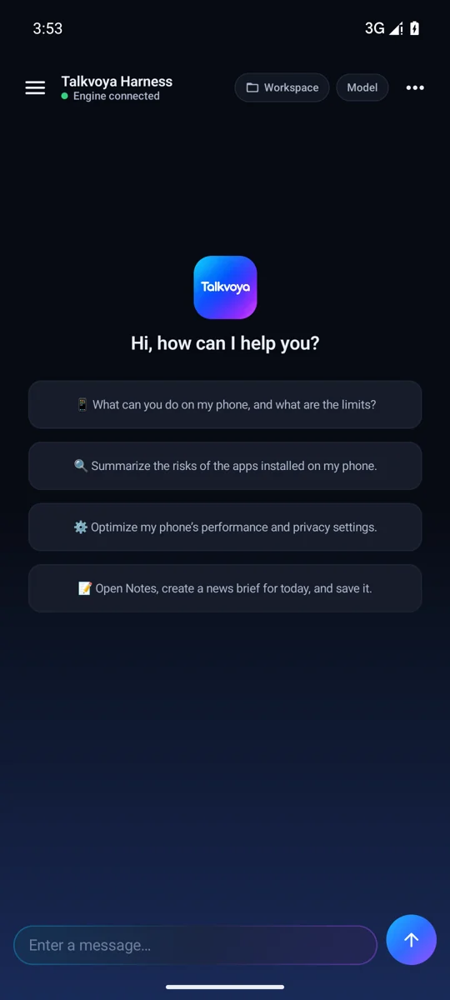
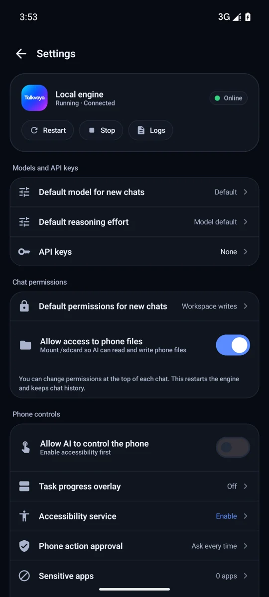

# Talkvoya Harness

**在 Android 上对话、处理文档，并按需开启手机操控。**

应用永久免费使用，支持 Android ARM64。请使用自己的模型 API 密钥，模型服务商可能按用量收费。

[**下载 Android APK**](DOWNLOAD.md) · [安装与帮助](HELP.md) · [English](README.md)

## 手机里的 AI 工作空间

- **对话和处理文档。** 起草内容、归纳资料，或把笔记整理成表格。
- **自己选择模型。** 使用自备的 API 密钥连接支持的 DeepSeek、OpenAI 或 Anthropic 服务，并在模型支持时调整思考深度。
- **跟进任务进度。** 查看工具活动，按需使用悬浮窗跟进、补充指令或停止任务。
- **按需开启手机操控。** 在设备上管理无障碍权限和敏感应用名单。

## 应用界面

  

## 开始使用

[下载中心](DOWNLOAD.md) · [安装与故障排查](HELP.md) · [最新版本说明](RELEASE_NOTES.md) · [隐私、权限与许可](TRUST.md) · [联系我们](../SUPPORT.zh-CN.md)
